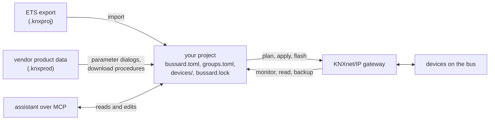
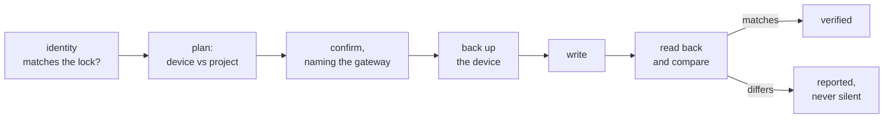

# How bussard works

bussard keeps a KNX installation as text files and treats the devices as the
place those files get written to. This page explains the pieces and how a
command moves between them.

## Your project is the source of truth

A KNX device holds tables and parameter memory, but none of the meaning: no
room names, no group-address names, no record of why a parameter has its
value. ETS keeps the meaning in the ETS project file, and an owner without that
file faces a reconstruction job. bussard keeps it in your bussard project:

| File | Holds | Written by |
|---|---|---|
| `bussard.toml` | the gateway, lint settings | you |
| `groups.toml` | the group-address plan with names and data types | you, or `import` |
| `devices/<address>.toml` | one device: name, room, parameters, links per channel | you, or `import` and `adopt` |
| `bussard.lock` | what the device runs: product, application, derived keys | `import` and `adopt` only |

A group address, such as `1/0/4`, is the shared name a button and an actuator
use to talk. Everything but the lock is yours to edit, by hand or through an
assistant. Your project is plain text, so a change is a diff, and the directory
can live in git or travel as a single bundle file.

Nothing bussard writes to a device changes your project. Your project
changes first, then a command carries it to the device.

## A device has three layers

A device's configuration has three parts of very different difficulty, and
bussard has a command for each:

| Layer | What it is | Commands |
|---|---|---|
| Address | the device's own address on the bus, such as `1.1.4` | `assign`, `adopt` |
| Links | the group-address, association and com-object tables | `plan`, `apply` |
| Parameters | channel modes, run times, alarm behaviour | `flash`, and `apply` for parameters that have a memory cell |

The address is a standard procedure that works on every device. The link
tables are standard loadable parts, written through documented interface
objects on System B devices. The parameters live in a memory layout that only
the vendor's product data describes, which is why the third layer needs a
`.knxprod` file.

## Product data makes parameters possible

A `.knxprod` is the vendor's product database. It describes the parameters
and their dialog, where each one sits in memory, the com-objects, and the
download procedure ETS follows for that device. bussard reads the file you
supply, generates a description of each application program (the firmware-side
program the vendor ships for the device) under `.bussard/`, and interprets the
vendor's download procedure when it flashes. It never ships or redistributes
product data.

The lock pins which application program each device runs, so a device file is
validated against the right dialog and a flash writes the right image.
`bussard device <address>` shows that dialog, page by page, as ETS would.

## The bus is shared and slow

bussard talks to the installation through a KNXnet/IP gateway, in tunnelling
or routing mode. Reading never changes a device: `monitor`, `read`, `scan`,
`describe` and `plan` decode and compare against your project and are never
gated.

Writing is physical and is gated, so a write to a gateway that is not on
localhost needs an explicit opt-in. A tunnelling interface has a fixed number
of connections, and every running bussard command, ETS and a visualisation
each hold one.

## Every write is plan, confirm, write, verify

Every device write runs the same sequence, whether it starts on the CLI or in
the MCP programming tier:

1. read the device's identity and compare it with the lock,
2. read the live tables or parameters and show the difference to your project
   as a plan,
3. ask for confirmation, naming the gateway,
4. back up the device (not on `flash`, which rewrites a device wholesale),
5. write,
6. read back and compare with your project.

A result says "verified" only when the read-back matches.

## The assistant is an operator

`bussard mcp` exposes your project and the bus to an LLM assistant. The default
server reads: it answers "what do I have", decodes telegrams, and edits the
project. Every edit is snapshotted first and rendered as a sentence, so
you judge a sentence and `undo` takes it back.

Group writes need `--allow-writes`, device programming needs
`--allow-programming` and an approved plan, and protected group addresses are
refused over MCP without an override. The split is deliberate: the assistant
proposes and edits text, and a human runs the physical steps or approves each
one.

## ETS still fits

ETS remains the tool for certification, planning and the odd device bussard
cannot program. The two meet through files:

- `bussard import` reads an ETS project export,
- `bussard diff` shows in sentences what a new export would change,
- `bussard keys export` writes a keyring ETS accepts.

ETS signs its project files, so bussard cannot write into a `.knxproj`. A
change made in bussard is carried to ETS by hand from the diff.

## Next steps

- [Safety](safety.md): the rules to read before your first write.
- [What each write command does](write-commands.md): the rails of every write.
- [The project folder](../reference/model-directory.md): every file and folder bussard keeps.
- [Product data](../reference/product-data.md): how `.knxprod` files are handled and stored.
