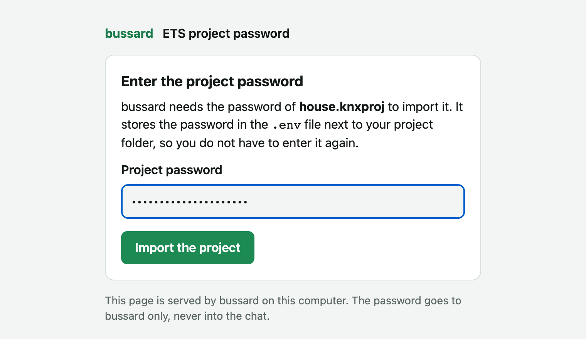

# Your first project

In fifteen minutes you turn your installation into a bussard project on your laptop and watch the bus decode itself against it. You start from an ETS project export if you have one, or from nothing.

You need:

- bussard on your `PATH` ([Install bussard](install.md)),
- a KNXnet/IP interface or router on the same network as your laptop,
- optionally, the ETS project export (`.knxproj`) and its password.

Nothing on this page writes to a device. Every command here only reads the bus.

## Create the project from an ETS export

=== "In chat"

    Register the server on an empty folder, as [Connect an assistant](assistant.md) shows, put the export next to that folder, and say:

    ```text
    You:        Set up my house. The ETS export is demo-house.knxproj.
    Assistant:  (calls knx_setup with project_file: demo-house.knxproj)
                Found the KNX IP Interface at 192.0.2.10. Imported 33
                group addresses, 10 devices and 55 links.
    ```

    `knx_setup` runs what `bussard init` runs, product data from the export included. Afterwards the assistant has its full tool set in the same conversation.

=== "At the terminal"

    Make an empty folder for the project and import the export into it:

    ```console
    $ mkdir house && cd house
    $ bussard import ../demo-house.knxproj
    imported 33 group addresses, 10 devices, 55 link entries → the current directory /home/me/house
    ```

    `bussard init` does the same in one step, and also finds your gateway and writes it into the project:

    ```console
    $ bussard init ../demo-house.knxproj
    Found gateway: KNX IP Interface (192.0.2.10:3671, IA 1.1.250)
    imported 33 group addresses, 10 devices, 55 link entries → the current directory /home/me/house
    validation: 0 error(s), 4 warning(s)
    ```

The export is usually password-protected. At the terminal bussard asks for the password, or takes it from `BUSSARD_PROJECT_PASSWORD` in the `.env`. In chat, bussard opens a password form in your browser, so the password never goes through the chat, and stores what you type in the `.env` next to the project folder. A chat app that cannot show the form tells you to put it there yourself. bussard then looks up the vendor product data for every device (the `.knxprod` files that describe each device's parameters), lists what it would download, and asks once. A device without product data still gets its file, with its identity, location and links.

<figure markdown="span">
  { width="560" }
  <figcaption>The password form bussard opens in chat. The page runs on your computer; the password never enters the chat.</figcaption>
</figure>

## Or start without one

=== "In chat"

    ```text
    You:        Set up my house. I have no ETS project.
    Assistant:  (calls knx_setup)
                Found the IP Interface at 192.0.2.10 and created an empty
                project.
    ```

=== "At the terminal"

    ```console
    $ mkdir house && cd house
    $ bussard init
    Searching for KNXnet/IP gateways on the local network...
    Found gateway: IP Interface (192.0.2.10:3671, IA 1.1.250, 4 tunnels, 1 in use)

    Created a fresh bussard project in the current directory /home/me/house.
    ```

With no ETS project file, setup creates an empty project. It only reads from the network and writes the gateway's address into `bussard.toml`. Discovery does not cross subnets; if it finds nothing, name the address yourself (`bussard init --gateway 192.0.2.10`, or tell the assistant).

To fill it from the devices already on a line, `bussard reconstruct` reads what they carry into a project; [Start without an ETS project](../how-to/add-a-device.md#start-without-an-ets-project) shows that path. To add devices one at a time, see [Add a device](../how-to/add-a-device.md).

## Check the project

=== "In chat"

    ```text
    You:        Is the project sound?
    Assistant:  (calls knx_validate)
                No errors, 4 warnings.
    ```

=== "At the terminal"

    ```console
    $ bussard validate
    0 errors, 4 warnings
    ```

    `validate` never prompts, and exits non-zero when it finds an error. Warnings alone exit 0.

The check runs offline, on the files only.

## Watch the bus

=== "In chat"

    ```text
    You:        I just pressed the hallway button. What did you see?
    Assistant:  (calls knx_recent_telegrams)
                Push Button Hallway sent "on" to Hallway Light Switch,
                and the switch actuator reported Hallway Light Status on.
    ```

=== "At the terminal"

    ```console
    $ bussard monitor
    12:03:44.809  1.1.1 Push Button Hallway → 0/0/0 Hallway Light Switch = On (1.001, obj "Rocker 1")
    12:03:44.981  1.1.3 Switch Actuator     → 0/0/1 Hallway Light Status = On (1.001)
    ```

    `bussard monitor --filter 0/0` shows only the telegrams you name.

Press a button in the house and its telegram appears. Each `monitor` line reads left to right:

- `1.1.1` is the sender's address, the device's own address on the bus.
- `0/0/0` is the group address, the shared channel a button sends to and an actuator listens on.
- `1.001` is the data point type (DPT), which says how to read the value: here a switch, on or off.

The names come from your project. A group address or type that is not in your project shows as raw hex, never as an error.

## What the project folder holds

| File | Holds | Written by |
|---|---|---|
| `bussard.toml` | the gateway, lint settings | you |
| `groups.toml` | the group addresses with names and data types | you, or `import` |
| `devices/<address>.toml` | one device: name, room, parameters, links per channel | you, or `import` and `adopt` |
| `bussard.lock` | what each device runs: product, application program | `import` and `adopt` only |

A device holds tables and memory, but no names and no record of why a setting has its value. Your project holds that meaning, so this folder is your installation as files. Everything except the lock is yours to edit, by hand or through an assistant.

A device file reads like its ETS dialog, one table per channel. From a real import of a Jung switch/blind actuator:

```toml
[channel.relaisausgaenge-1]
betriebsart = "Lüftungsklappe / Dachfenster"
langzeitbetrieb.listen = ["3/1/20"]
rueckmeldung-lueftungsklappen-dachfensterposition.send = "3/1/23"
```

You never pass the directory: every command finds the project from the current directory, then `./knx`, then the parent directories.

!!! note
    bussard also keeps `products/` (the vendor product data it downloaded) and `.bussard/` (generated files and the history of every change) next to your project files. bussard never redistributes vendor product data; it fetches it for your project only.

## Keep passwords in `.env`

Put the passwords in a `.env` file in the project folder or in its parent:

```
BUSSARD_PROJECT_PASSWORD=...
BUSSARD_KEYRING_PASSWORD=...
```

`BUSSARD_KEYRING_PASSWORD` unlocks your key store (`bussard.keys`) and ETS `.knxkeys` files. Every command reads the file, so you do not export the passwords in each shell. The `.gitignore` that `init` and `import` write already lists `.env`. `BUSSARD_ALLOW_REAL_GATEWAY` is never taken from this file: opening writes to the real bus stays a flag or an exported variable.

## Before your first write

!!! warning
    bussard writes to real building hardware. Read [Safety](../explanation/safety.md) once before you use `write`, `apply` or `flash`. Every device write is plan, confirm, write, verify; a write to a gateway that is not on your laptop is refused until you pass `--allow-remote-gateway`.

## Next steps

- [Connect an assistant](assistant.md): let an LLM read your project and watch the bus with you.
- [The first weekend](first-weekend.md): back up every device, make one change and undo it.
- [Watch the bus](../how-to/watch-the-bus.md): read values, capture traffic, see the network in a browser.
- [How bussard works](../explanation/how-it-works.md): the project, the product data and what a write does.
