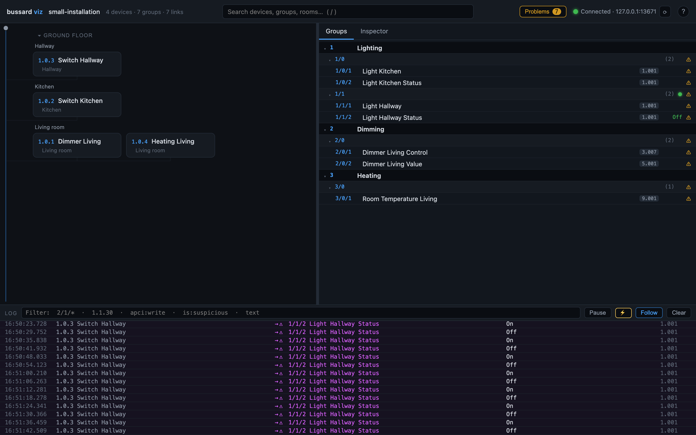
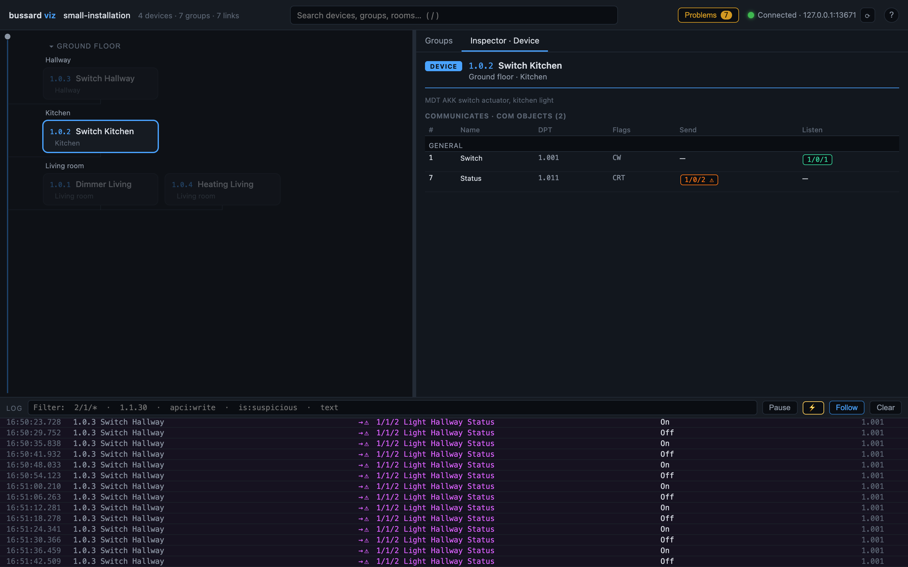

# Watch the bus

Watch telegrams as they happen, read a single value, see the installation in a browser, and keep a history you can query later. Everything on this page only listens, except a read, which asks one device for one value.

## Watch and decode the bus

=== "In chat"

    An illustrative exchange:

    ```text
    You:        What just happened on the bus?
    Assistant:  (calls knx_recent_telegrams)
                The weather station raised the wind alarm. A moment later
                the hallway push button switched the hallway light on, and
                the switch actuator reported it on.
    You:        Tell me when someone presses a button in the hallway.
    Assistant:  (calls knx_wait_for_telegram)
                Hallway push button just sent "on" to Hallway light.
    ```

    `knx_recent_telegrams` returns the latest telegrams the server has decoded, filtered by group address or sender. `knx_wait_for_telegram` waits up to five minutes for the next matching one. A secured telegram arrives decrypted when the server holds its key.

=== "At the terminal"

    ```console
    $ bussard monitor
    12:03:41.221  1.1.7 Weather Station    → 3/0/0 Wind Alarm           = Alarm (1.005, obj "Wind Alarm")
    12:03:44.809  1.1.1 Push Button Hallway → 0/0/0 Hallway Light Switch = On (1.001, obj "Rocker 1")
    12:03:44.981  1.1.3 Switch Actuator     → 0/0/1 Hallway Light Status = On (1.001)
    ```

    Each line is one telegram: the sending device, the group address it went to (a group address such as `0/0/0` is the shared channel a button and an actuator both use), its name, and the decoded value. Flip a switch and watch it name itself.

    Narrow the stream with `--filter 3/2/0,1/0/`: group addresses, group-address prefixes, or sender addresses such as `1.1.30`. `--json` prints one JSON object per line for other tools.

    Secured telegrams (KNX Data Secure) decode only with the keyring: pass `--keyring <file.knxkeys>` and set the password in `BUSSARD_KEYRING_PASSWORD`. Decoded ones are marked `[secured]`.

A group address that is not in your project shows as raw hex. Give it a `dpt` in `groups.toml` (its data type, which tells bussard how to decode the value), or let the assistant do it, and it decodes from then on.

## Read a value

=== "In chat"

    ```text
    You:        Is the wind alarm on right now?
    Assistant:  (calls knx_read_group)
                Wind alarm answered: no alarm.
    ```

    `knx_read_group` sends one read request and returns the decoded answer. The default server may send reads; a server started with `--passive` does not offer the tool.

=== "At the terminal"

    ```console
    $ bussard read 3/2/0
    ```

    `read` sends one read request to the group address and prints the typed answer. It exits non-zero when nothing answers within 3 seconds. `--json` prints the result as one object, with `answered` set to `false` when no answer came.

    A secured group address needs `--keyring`. Without a key for it, `read` refuses before sending anything.

## See the installation in a browser

The browser view is a terminal command in both forms: ask the assistant and it names the command for you.

```console
$ bussard viz
bussard viz serving on http://127.0.0.1:8080 (Ctrl-C to stop)
read-only: group writes return 403 (pass --allow-writes to enable them)
```

Open the address. You get every device drawn along the bus by floor and room, the group-address tree, and live telegrams as they happen. Select a device or a group address to see its links, senders and listeners. With no reachable gateway the page still shows your project, without live traffic.



Select a device and the inspector shows its com objects with their types, flags and group addresses:



A bare `bussard viz` never transmits, so it is safe to point at the live installation. It holds one tunnelling slot of your interface while it runs (see [Find what you have](find-what-you-have.md)).

!!! warning
    `--allow-writes` arms test-write buttons on the page, and `--watch-prog` sends a programming-mode query on the bus at intervals. Both transmit. Against a gateway that is not on your own machine the server refuses to start without `--allow-remote-gateway`. Every armed write asks you to confirm the group address and the gateway, and a `protected` group address needs a force checkbox on top.

## Capture a history and query it

```console
$ bussard capture --to knx/captures/bus.db --filter 3/
```

Recording to a file is a terminal command too. `capture` writes every matching telegram into a SQLite file, created if absent. It stores the raw bytes next to the decoded value, so you can decode the history again after you fix a name or a type in your project. `--filter` works as for `monitor`, and `--keyring` decrypts secured telegrams.

Query the file with any SQLite tool:

```console
$ sqlite3 knx/captures/bus.db \
    "SELECT ts_utc, source, destination, apci FROM telegrams
     WHERE destination = '3/2/0' ORDER BY ts_utc DESC LIMIT 10"
```

Or give it to the assistant, which then sees telegrams older than its own memory holds:

```console
$ claude mcp add knx -- bussard mcp --dir knx --capture-db knx/captures/bus.db
```

The table layout is in the [JSON and capture reference](../reference/json-output.md).

## Name group addresses from live traffic

=== "In chat"

    ```text
    You:        Help me name the group addresses.
    Assistant:  Press a button you know, then tell me which one it was.
    You:        The ceiling light switch in the kitchen.
    Assistant:  (calls knx_wait_for_telegram, then knx_infer_group)
                Device 1.1.30 in the kitchen sent "on" to 1/0/1. Its com
                object declares 1.001 (switch), high confidence.
                I would call it "Kitchen ceiling light, switch". OK?
    You:        Yes.
    Assistant:  (calls knx_set_group)
                1/0/1 is now Kitchen ceiling light, switch, type 1.001.
    ```

    `knx_wait_for_telegram` waits for the press, `knx_infer_group` ranks the possible types and proposes a name, and `knx_set_group` writes the one you agreed to. The loop works with a `--passive` server.

=== "At the terminal"

    ```console
    $ bussard learn --untyped --gateway 192.0.2.10

    [1/12] 1/0/1: trigger the object you want to name (waiting up to 30s)
      1/0/1  sender 1.1.30 Schaltaktor (Kitchen)
      com object 3 Kanal A - Schalten, channel Ceiling light, declares 1.001
      payload 01 (1 byte(s))
        1. 1.001 [high] the sending com object declares DPT 1.001 in the model
      proposed name: Kitchen ceiling light, schalten
      accept as "Kitchen ceiling light, schalten" / 1.001? [a]ccept, [e]dit name, [d]pt, [s]kip, [q]uit:
    ```

    `learn` asks you to press a button, waits for the telegram, and proposes a type and a name. Accept, edit the name, change the type, skip, or quit.

    | Flag | What it learns |
    |---|---|
    | `--untyped` | Every group address in your project without a type |
    | `--unnamed` | Every group address with a placeholder name |
    | `--ga <GA>` | The addresses you name, in that order (repeatable) |
    | none | Whatever appears on the bus next, until a wait times out |

    `--timeout` changes the 30-second wait.

The proposal comes from the sending device's room, channel and com object (one input or output of a device). Press the same button again when the candidates are uncertain: each extra telegram narrows them. Accepted answers go into `groups.toml`, and into the sending device's file when the com object is clear. Either way nothing is transmitted; only files change. Review the result with `bussard validate`, or ask the assistant to validate.

## Next steps

- [Find what you have](find-what-you-have.md): list devices, gaps in your project, and what bussard can do with each device.
- [Change what a button does](change-a-link.md): the first write, with plan and undo.
- [Bus commands reference](../reference/commands/bus.md): every flag of `monitor`, `capture`, `read` and `learn`.
